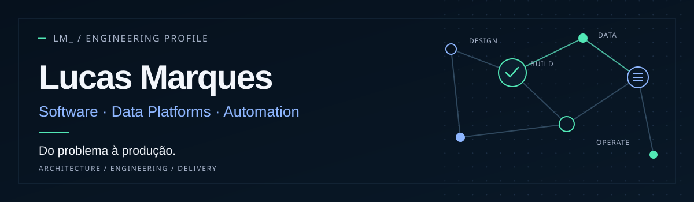

  

### Olá, sou Lucas Marques.

Entendo problemas e construo soluções digitais **do problema à produção**. Trabalho na interseção entre **engenharia de software, plataformas de dados e automação**, conectando arquitetura, implementação e operação com necessidades reais de negócio.

[LinkedIn](https://www.linkedin.com/in/lucas-marques-0a123720b/) · [GitHub](https://github.com/O-marqs)

---

### O que eu construo

| Área | Foco |
| --- | --- |
| **Software engineering** | APIs, aplicações web, integrações, arquitetura e qualidade de código. |
| **Data & platform engineering** | Pipelines, lakehouse, governança, orquestração e confiabilidade. |
| **Automation & operations** | Serviços Python, automações testáveis, observabilidade e melhoria contínua. |

### Selected work

**[Open Source Data Platform](https://github.com/O-marqs/projeto-data-platform)**  
Plataforma self-hosted em evolução: componentes de lakehouse, catálogo e serviços de controle. **Projeto pessoal · em desenvolvimento**.

**[NYC TLC Data Engineering Case](https://github.com/O-marqs/ifood-tlc-data-engineering-case)**  
Pipeline analítico com PySpark e camadas Bronze, Silver e Gold, com verificações de qualidade e documentação técnica. **Projeto público**.

> Mais cases de software, plataforma e análise de mercado serão incluídos quando suas versões públicas e materiais de apresentação estiverem prontos.

### Technologies & practices

`Python` · `FastAPI` · `SQL` · `PySpark` · `React` · `TypeScript` · `PostgreSQL` · `Docker` · `AWS` · `GitHub Actions`

**Como trabalho:** pensar no problema, explicitar decisões de arquitetura, construir com testes e tornar a entrega compreensível e sustentável.

---

São Paulo, Brasil · © Lucas Marques
